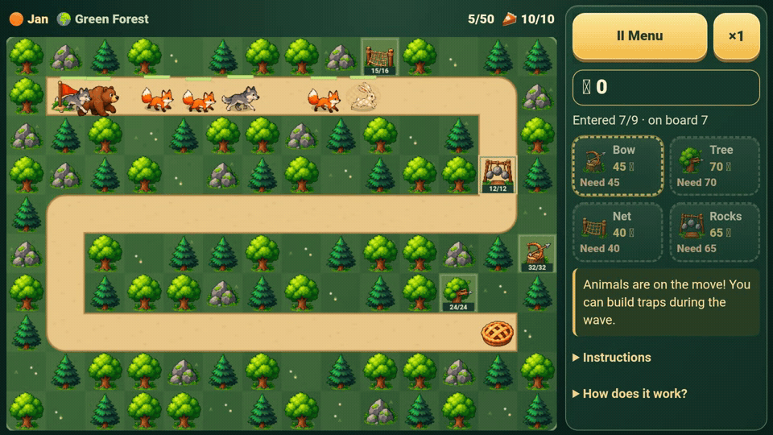

# Foxes & Pie

Created by my son **Jan** and his friend **Martin** through **vibe coding**, turning their ideas into a playable game with AI assistance. Both were **7 years old** when they came up with the game.

A browser game by Jan and Martin: place traps and protect the pie from foxes, wolves, bears, and hares. Features include Russian, English, and Dutch interfaces, custom names for 1–4 players taking turns, sound effects, trap upgrades, and a mobile layout.



Level 5 · Android emulator · normal speed

<a href="https://ramantsitou.github.io/fox-and-pie/"></a>

Scan the QR code to play on your phone.

Play: https://ramantsitou.github.io/fox-and-pie/

## Development

Requires Node.js 22 or newer. There are no third-party dependencies.

```sh
npm ci --ignore-scripts
npm test
npm run build
```

- `docs/gameplay.gif` — a five-second recording of live gameplay in an Android emulator, used only by this README.
- `assets/woodland-atlas.png` — the illustrated animals, traps, scenery, pie, and flag.
- `index.html` — the application interface, styles, translations, and game logic.
- `sw.js` — the PWA's offline cache.
- `manifest.webmanifest` and `icons/` — app installation settings and icons.
- `tests/game.test.cjs` — game rules, turn changes, bosses, upgrades, translations, and PWA event handlers.
- `tests/fullscreen.test.cjs` — Android fullscreen entry, hiding navigation controls, browser permission failures, and user-initiated exits.
- `tests/responsive-update.test.cjs` — proportional screen fitting, touch accuracy, automatic PWA updates, and progress preservation.
- `tests/ux.test.cjs` — saved-game recovery, wave checkpoints, pause, safe restart, placement guidance, upgrade previews, and turn results.
- `tests/sw.test.cjs` — service worker installation, caching, offline startup, and scope boundaries.
- `tests/build.test.mjs` — build contents, cache version updates, and rejection of invalid source files.
- `scripts/build.mjs` — validates the source and builds `dist/`. The cache version depends on the game's contents, so a changed build updates the PWA cache.

For local play, serve `dist/` over localhost after building, or open the source HTML file directly. PWA features require HTTPS or localhost. Official publication is handled exclusively by the GitHub Actions pipeline. See `INSTALL.txt` for installation details.

## Language, fullscreen, and installed PWA updates

On first launch, the interface follows the browser’s preferred supported language (Russian, English, or Dutch), including regional variants. If none matches, it uses English. A language chosen in the menu is saved and takes priority on later visits.

The installed PWA requests fullscreen landscape mode at launch. On phones in a regular browser, the first ready/start gesture requests immersive fullscreen; browser restrictions may prevent it. There is no fullscreen menu button.

On phones, the board fits the largest possible 14:10 rectangle in the available area to the left of the shop, keeping cells square and artwork proportional. Mobile controls use short labels with complete accessible names, a single-line coin balance, and a two-column settings menu. Installation help is collapsed. The workshop and settings scroll independently, including touch scrolling after manual rotation. Gameplay messages and placement instructions appear in the workshop beside the board; the handoff dialog appears over the stopped field. On desktop, the workshop scrolls within the available height. On phones, the canvas accounts for screen pixel density. Touch coordinates are calculated from its actual dimensions, including manual rotation.

The app checks for a new service worker when it opens, when the player returns to it, and once a minute while it is running. A new version activates only after the complete offline cache has downloaded successfully. The page waits until the current wave ends before restarting. Before the restart, it saves the level, player, pie, traps, coins, and speed settings in sessionStorage. The new page restores them. If the browser blocks sessionStorage, the game does not restart automatically, to avoid losing progress.

A closed PWA is not guaranteed to update immediately: it checks when it next opens or the player returns to it. Internet access is needed to download a new version, not for regular offline play.

## Animals and traps

Foxes head for the pie, wolves tear through nets, bears can deflect arrows, and hares can jump over rock traps. Bows, arrow trees, nets, and rock traps each have distinct attacks. Animated footsteps, trap recoil, flying projectiles, torn nets, and ricocheting arrows show what happens during combat.

## Saved games and gameplay controls

A new game starts with player setup: start with one player and add up to three friends. Each player has a distinct color. Entered names appear on their own; unnamed players are called Player 1, Player 2, and so on. Names are optional (up to 24 characters); duplicate names are allowed. Players share the pie, coins and traps, and take turns in order after a completed level or a failed attempt. A solo player keeps the next turn. Names and the current player are saved with progress; changing the interface language does not change entered names. Existing saves without a roster retain their original two players. Starting over opens player setup again; progress resets only when Play is pressed. A solo game opens directly in preparation mode.

The game saves the setup and results locally between waves. Reopening the page shows **Continue game** with the saved level, player, and pie. A reload or app closure during combat restores the setup from the start of that wave; the wave is replayed, rather than restoring animals in motion. Upgrades or purchases made during an unfinished wave are rolled back to that checkpoint. Saved games stay on the same device and browser origin.

During combat, the Menu button opens the pause menu with an explicit Resume button. Opening the menu or the new-game confirmation pauses the battle. After a background/blur event, the game waits for an explicit resume. Starting over requires confirmation; canceling preserves the current game and keeps combat paused until Resume is pressed. If local saving is blocked, play continues with a visible save warning.

Valid trap squares are highlighted after selecting a trap. Unaffordable cards remain selectable for guidance, but show the missing coins. Upgrade buttons preview the next damage (or net duration) and maximum durability. A player badge remains visible above the board. The wave preview lists animal counts, introduces new animal abilities, and becomes an entered/alive counter during combat. Handoff dialogs retain the previous result, including lost pie, refunds, and coin/trap rollback on a failed attempt.

## GitHub Actions and deployment

`.github/workflows/ci.yml` runs for pull requests targeting `main`, pushes to `main` (including merges), and manual runs.

The sequence is: install from the lockfile → tests → build → upload the Pages artifact → deploy to GitHub Pages. Publication depends on successful verification. Deployment runs only for `main`, including after a pull request is merged. Pull requests never deploy. A failed test or build prevents publication. Only deployment jobs receive `pages: write` and `id-token: write`; pull requests have read-only repository access. No personal deployment token is required.

The site is published from the contents of `dist/` at:

https://ramantsitou.github.io/fox-and-pie/

The app's manifest, service worker, and icon paths are relative, so the `/fox-and-pie/` project-site path works for installation and offline play. The `github-pages` environment links to each deployment. In repository settings, Pages uses **GitHub Actions** as its publishing source.

## Optional browser regression checks

After building, run the Chromium checks with Playwright installed in the development environment:

```sh
npm install --no-save --package-lock=false playwright
npx playwright install chromium
npm run build
npm run test:browser
```

Playwright is an optional development tool, not an application dependency or part of the deployment pipeline. If it is installed elsewhere, set `PLAYWRIGHT_MODULE` to that package's absolute path. The script serves `dist/` on localhost port 4173 and writes screenshots and measured layouts to `artifacts/ux/` (ignored by Git).

The checks cover Russian, English, and Dutch at 568×320, 740×360, 844×390, 915×412, manually rotated 390×844, and desktop 1280×800. They capture all five environments, exercise trap purchase/confirmation/cancel, upgrades, repairs, sales, pause/resume, restart confirmation, wave checkpoint recovery, and failed-turn handoff. Additional render fixtures show all animal types facing both directions, trap tiers, breakage, and net effects. An offline reload verifies the built service worker and illustration atlas. Fullscreen requests are disabled in these viewport checks to preserve the requested dimensions; native fullscreen behavior has separate unit coverage and still needs real-device testing.

After completing all 50 levels, a thank-you screen introduces the game’s creators, Jan and Martin, with an illustration of two friends and a link to the GitHub repository. Play again opens player setup before resetting progress. On landscape phones, including manual rotation, the illustration sits beside the text and both buttons fit without scrolling. Both illustration variants are included in the offline cache.
